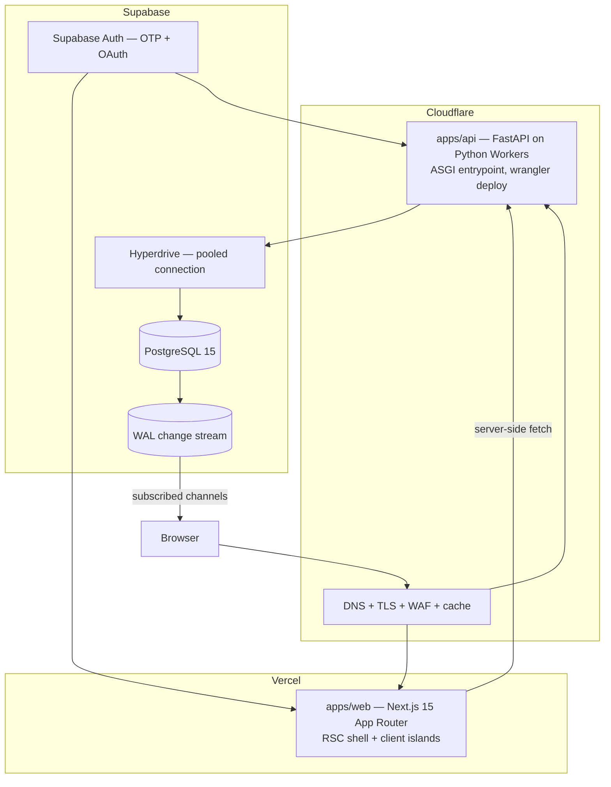
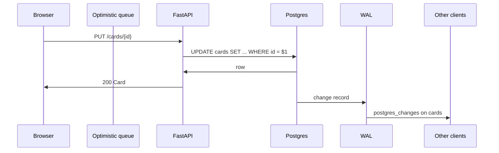
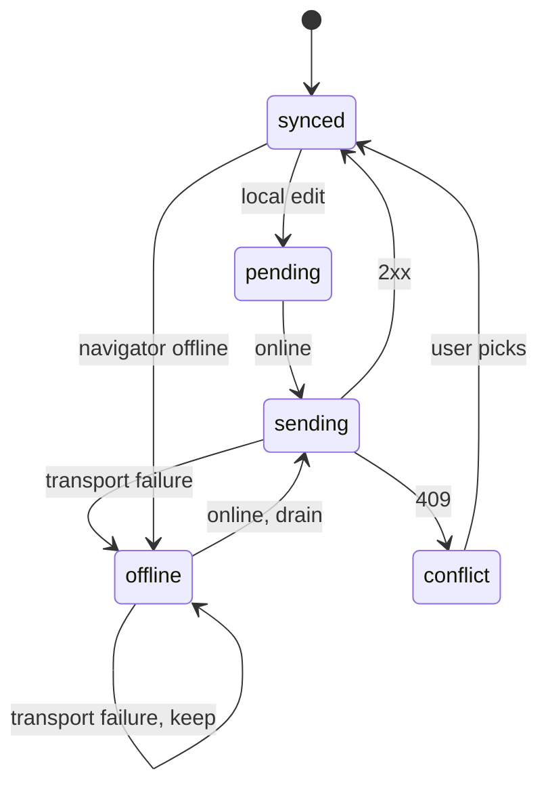

# Architecture: Teammate

## Topology

Cloudflare is both the edge and the runtime. There is no separate Python host to secure or certificate to manage.

Read this as two independent paths, not one pipeline. The **request path** (`browser → Cloudflare → Vercel` and `browser → Cloudflare → FastAPI`) handles auth and fetches. The **realtime path** (`Postgres → WAL → browser`) handles propagation and never touches FastAPI or Vercel.

## The two rules that decide everything

### Rule 1: Cloudflare is the runtime, not a proxy in front of one

Python Workers reached general availability on 2026-09-21. FastAPI runs on Cloudflare through its own ASGI server (`workers.asgi`), so uvicorn is not needed and there is no separate Python host. The statement "Cloudflare cannot host Python" is false, and an earlier version of this document asserted it. See ADR-0003 for the verified sources.

What Cloudflare provides:

| Does | Does not |
|---|---|
| Run the FastAPI ASGI app | Run async SQLAlchemy (no greenlet support) |
| Terminate TLS and serve DNS | Run CPython native extensions |
| WAF and rate-limit write endpoints | Give a conventional process lifetime |
| Cache marked API GETs | Stream realtime (that is Supabase's job) |

The data layer is where the runtime bites. **Async SQLAlchemy is unsupported**, which is why no async ORM appears anywhere in this system. Postgres is reached with `asyncpg` directly against SQL, through Hyperdrive for pooling.

### Rule 2: realtime goes through the database, not through FastAPI

Supabase Realtime broadcasts Postgres changes to subscribed clients. FastAPI holds no sockets. So: **a write that does not reach Postgres does not propagate.** This is the constraint that makes the design simple. There is no second transport to keep consistent with the database, and a client reconnecting only needs to resubscribe, not replay a server-side event log.

What it costs: every write is a Postgres round trip. Accepted for MVP. Every subsequent decision below preserves this rather than working around it.

## Data flow

### Write path

### Reconnect path

The queue in the browser is the source of truth for unsent work. On `online`, drain oldest-first. Each send either lands (drop from queue) or fails 4xx (drop, conflict) or fails 5xx/network (keep, backoff). A server `409` means a newer `updated_at` exists, which becomes the visible conflict; the queue does not auto-resolve it.

## Optimistic updates

`apps/web/lib/realtime/optimisticQueue.ts` owns a single FIFO of pending mutations. Rules:

- An optimistic id is a ULID generated client-side, so a card created offline has a stable id before it reaches the server. Never `Math.random()` and never a `Date.now()` counter — both collide across sessions.
- Each entry carries `origin: "local" | "remote"`. A remote echo for an id already queued locally updates the queued entry rather than appending a second one. This single rule is what prevents duplicate cards on reconnect.
- The queue is in-memory with a localStorage mirror of the id set. Mirror holds ids only, not payloads: a payload larger than what one card needs is wasted bytes, and ids are enough to dedupe the echo.
- Sending is serial, not parallel. Parallel sends reorder on the server and the resulting `position` values contradict the client's intent.
- Backoff is exponential with jitter, capped at 30s.

## Ordering under concurrency

Positions are per-parent integers, contiguous from 0, rewritten by the `reorder_positions()` trigger in `supabase/migrations/001_init.sql`. Compacting to `row_number()` after every change means there are no gaps to disagree about.

The failure this avoids: two clients each holding `position = 3` for different cards. With gap-based ordering they interleave unpredictably. With compaction each move produces a canonical order the whole workspace converges on.

Cards moved between lists change parent, so they compact into the destination. A card moved to the same list at a new index compacts in place.

Real-time convergence for a drag is therefore: local apply immediately, server write on release, server broadcast, every client compacts to the same row order. Two simultaneous drags converge to one of the two orders — whichever lands second. That is last-write-wins and it is the documented policy.

## Conflict policy

Last-write-wins per row, `updated_at` as the arbiter. Deliberately not a CRDT.

Reasoning: field-level CRDTs buy conflict-freedom for concurrent edits to the same field, which for this domain means two people typing in the same card description within the same second. That is rare and, when it happens, LWW degrades to "one edit wins" rather than corruption. A CRDT adds permanent complexity to every model, every write path, and every reconnection for a case the product can survive.

The one place LWW visibly hurts is the queue replay case: an offline edit that lost a race should not silently vanish. So `409` surfaces a conflict state the user resolves, rather than the server silently discarding.

## Auth and authorization

Authorization is enforced in Postgres RLS, not in application routing. A client-side redirect is UX; a policy is the boundary. Consequence: a user removed from a workspace loses access on their next query, with no cache invalidation step and no server restart.

- `workspace_members` is the single role table. Every policy routes through `workspace_role_of()`.
- `SECURITY DEFINER` helper functions exist because a policy on `cards` must consult `workspace_members` through `lists` and `boards`, and RLS on those tables would otherwise recurse.
- The service-role key bypasses RLS. It lives only in `apps/api` env and never reaches the browser. A `NEXT_PUBLIC_` prefix on a Supabase key is the single most dangerous mistake available in this stack; lint rules and the boundary contract both forbid it.

## Module ownership

| Module | Owns | Must not |
|---|---|---|
| `apps/web/app` | RSC shell, route layout, auth redirects | Hold realtime state |
| `apps/web/lib/realtime` | Subscriptions, optimistic queue, sync state | Know React |
| `apps/web/components` | Presentation + local interaction | Issue Supabase queries directly |
| `apps/web/lib/api` | Typed FastAPI client | Contain business rules |
| `apps/api/routers` | HTTP shape, schema validation | Contain business logic |
| `apps/api/core` | Config, sessions, Hyperdrive connection | Use an async ORM |
| `supabase/migrations` | Schema, RLS, triggers, activity | Know the application |
| `packages/shared` | Cross-app TS types | Import from either app |

`lib/realtime` must not know React so the queue is testable without a renderer. `components` must not issue Supabase queries directly so the subscription surface stays one file.

## Deployment

| Target | Artifact | Notes |
|---|---|---|
| Vercel | `apps/web` | Root directory `apps/web`. Env: Supabase URL, anon key, Worker URL |
| Cloudflare Workers | `apps/api` | `uv run pywrangler deploy`. `wrangler.jsonc` with `python_workers` flag |
| Cloudflare | DNS, WAF, cache, rate limits | Terraform, `infra/terraform` |
| Hyperdrive | pooled Postgres connection | Binds to the Worker as `HYPERDRIVE` |
| Supabase | migrations | `supabase db push --link` |

No Dockerfile is needed for the API. `pywrangler` bundles dependencies into the Worker bundle at deploy time. `docker-compose.yml` remains a local-dev convenience only, and `mypy` in CI catches the async-SQLAlchemy trap early.

Before the Worker is called production-ready, three things must be verified in the actual runtime, not inferred from FastAPI compatibility: every dependency is a pure-Python or PyEmscripten wheel, Postgres connectivity through Hyperdrive holds under concurrent load, and no code path relies on a background task or socket. This is a blocking task in the plan.

## Failure modes and response

| Failure | Detection | Response |
|---|---|---|
| Client offline | `navigator.onLine` + failed send | Queue, badge, drain on reconnect |
| Realtime socket drops | `CHANNEL_ERROR` / `TIMED_OUT` | Resubscribe with jittered backoff |
| Worker unavailable | 5xx on send | Queue retries, UI badges |
| Stale client state | — | Resubscribe forces a fresh refetch of the board |
| Presence rows orphaned | 2-min TTL | `prune_stale_presence()` on a cron |
| Migration breaks RLS | Policy tests fail | Block merge; never ship a widening policy untested |

## What is deliberately out of the MVP

Recorded so a later session does not mistake these for bugs:

- Operational transform and CRDTs (see conflict policy).
- Card comments on cards inside lists inside boards — threads are flat and one level, per spec.
- Offline persistence of full board state. The queue holds pending mutations only; a hard refresh offline loses the board view.
- Redis or any second stateful service.
- Cross-workspace card moves.
